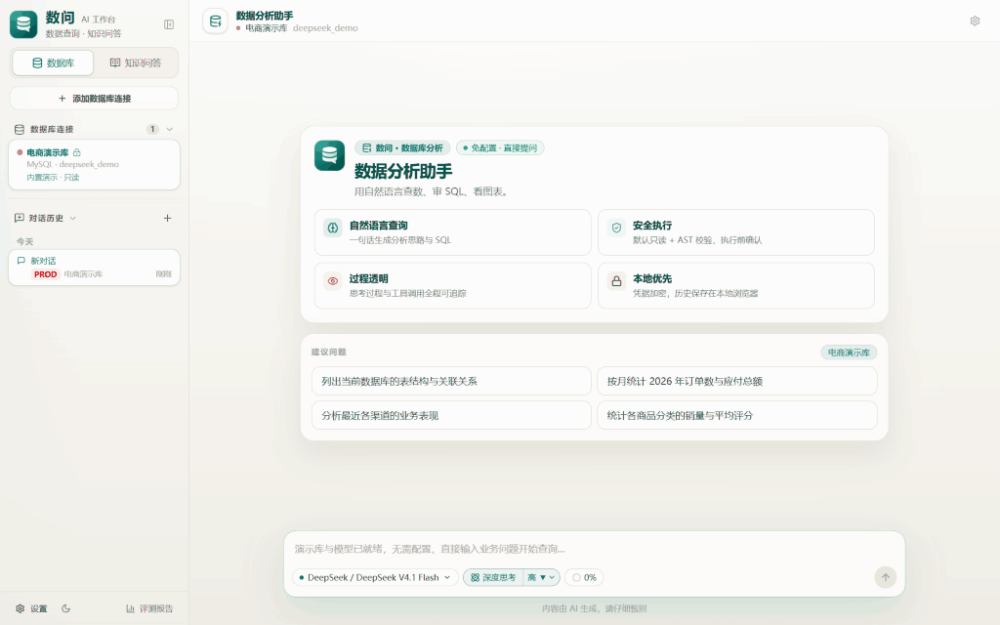
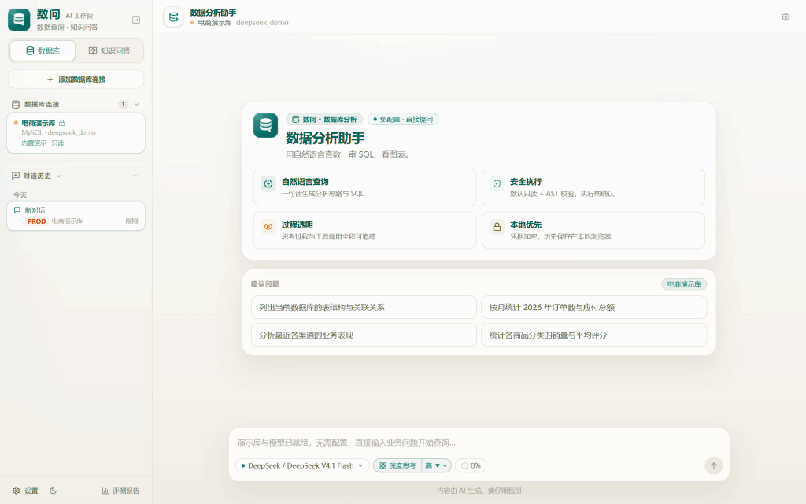
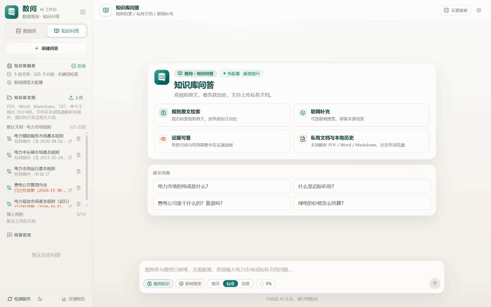

<div align="center">


# DataQuery Workbench · 数问工作台

**Local-first, zero-login, model-agnostic AI data & knowledge workbench**

Combine **MySQL Text-to-SQL analysis** and **regulatory RAG** in one interface —<br />
with real-time thinking visualization, AST-enforced safety, human confirmation, automatic charts, and clause-level citations.

<p>
  <a href="./LICENSE"></a>
  = 22" />
  
  
</p>

<p>
  <a href="https://deepseek-db-chat.vercel.app/workbench/dbpilot"><b>Live Demo</b></a>
  &nbsp;·&nbsp;
  <a href="#preview"><b>Preview</b></a>
  &nbsp;·&nbsp;
  <a href="#features"><b>Features</b></a>
  &nbsp;·&nbsp;
  <a href="#quick-start"><b>Quick Start</b></a>
  &nbsp;·&nbsp;
  <a href="#benchmarks"><b>Benchmarks</b></a>
  &nbsp;·&nbsp;
  <a href="./README.md"><b>中文</b></a>
</p>

</div>

---

## Preview

> 🚀 **Zero-Config Live Workspace**: [Text-to-SQL Workbench (`/workbench/dbpilot`)](https://deepseek-db-chat.vercel.app/workbench/dbpilot) · [Knowledge Q&A (`/workbench/knowledge`)](https://deepseek-db-chat.vercel.app/workbench/knowledge) · [Interactive Eval Report (`/workbench/evals`)](https://deepseek-db-chat.vercel.app/workbench/evals)
>
> Preloaded with a read-only e-commerce demo database (8 tables), 3 active regulatory documents, and a server-hosted model — open and click any suggested question right away.

### 1. Explore the Database

Ask how many tables exist and inspect the schema list. Metadata tools return all 8 base tables directly without generating redundant exploratory SQL.



### 2. From a Question to Dual-Axis Charts & KPI Summary

Ask for monthly order counts and total payable amounts, review and confirm the generated SQL, and inspect auto-generated dual-axis bar/line charts, sortable tables, and KPI summary cards in the linked Data Panel.



### 3. Regulatory Knowledge Q&A with Clause-Level Evidence

Ask an electricity-market regulation question (such as green electricity settlement pricing) to run PII checks, query rewrite, hybrid retrieval, and citation verification — complete with inline `[n]` citations, validity status, and a side-by-side Evidence Panel.



<details>
<summary>Recording notes</summary>

All three GIFs were recorded on the live workbench using **DeepSeek V4.1 Flash**, the [synthetic e-commerce dataset](./scripts/mysql-demo-seed.sql), and the bundled electricity-market regulation corpus. SQL was reviewed, confirmed, and executed against read-only MySQL; waiting intervals were shortened while preserving key interactive states. See [docs/demo/README.md](./docs/demo/README.md).

</details>

---

## Features

<table>
  <tr>
    <td width="50%" valign="top">
      <b>🔐 Local-First & Zero-Login</b><br />
      No accounts or server-side user database. Personal MySQL credentials, user API keys (encrypted with AES-256-GCM), full chat history, and uploaded document chunks stay in your browser's IndexedDB.
    </td>
    <td width="50%" valign="top">
      <b>🔀 Model Freedom & Prefix Caching</b><br />
      Native DeepSeek thinking mode with prefix cache optimization (<b>85%</b> measured hit rate), plus any OpenAI-compatible provider (Kimi, Qwen, GLM, SiliconFlow, OpenRouter, etc.) switchable in one click.
    </td>
  </tr>
  <tr>
    <td width="50%" valign="top">
      <b>🛡️ Defense-in-Depth SQL Safety</b><br />
      Server-enforced read-only defaults, AST SQL validation (rejecting executable comments and unparseable queries), human-in-the-loop confirmation, and model-boundary PII masking. SELECT results are capped at 500 rows with explicit truncation metadata.
    </td>
    <td width="50%" valign="top">
      <b>⚡ Dual-Engine Workbench</b><br />
      Unifies structured Text-to-SQL analytics and an in-process RAG engine — go from raw SQL charts and KPI summaries to clause-cited policy Q&A and private PDF/DOCX uploads in one app.
    </td>
  </tr>
</table>

### Text-to-SQL Analytics
- **Database Overview & FK Awareness**: One-click scan of table row counts, comments, auto-detected dictionary tables, and `INFORMATION_SCHEMA` foreign keys for accurate multi-table JOINs.
- **Smart Filter (`smart_filter`)**: Interactive parameter clarification for ambiguous date ranges, enums, or aggregation metrics before generating SQL.
- **Full Transparency & Self-Correction**: Real-time streaming of `reasoning_content` and tool execution traces; optional `EXPLAIN` pre-checks and structured error classification for intelligent SQL retries.
- **Interactive Data Visualization**: Paginated sortable tables with CSV export, automatic dual-axis bar/line/pie charts, and KPI summary cards.
- **Multi-Database & Resilient Execution**: Manage multiple MySQL connections with TLS/CA verification; built-in exponential backoff retries and native `suspend/resume` agent handoff.

### Knowledge Q&A (RAG)
- **In-Process & Zero External Deps**: Ships with 3 active electricity-market regulation documents chunked at chapter/section/clause boundaries, using Node `Intl.Segmenter` BM25 plus optional vector RRF hybrid retrieval.
- **Client-Side Private Uploads**: Upload PDF, Word (`.docx`), Markdown, or TXT files (default limit: 10 files / 10 MB per browser). Files are parsed locally in the browser and never saved to server disk; only relevant chunks are sent per query.
- **Citation Verification & Validity Tracking**: Validates inline `[n]` references against retrieved clauses and computes effective/expired status automatically, with optional general knowledge and Bocha web search.

<details>
<summary>Privacy & data boundary details</summary>

- **Local storage**: Personal connections, user-supplied API keys (AES-256-GCM encrypted), complete conversation history, and parsed private document chunks live in browser IndexedDB. Built-in demo credentials and server API keys never leave the server.
- **Model transfers**: Questions, required schema context, and rule-masked query results are sent to the selected model provider. Knowledge Q&A sends masked queries and retrieved excerpts (plus optional embedding/web-search APIs when configured).
- **Masking & telemetry**: Model-boundary masking covers common PII and structured sensitive fields (complementing, not replacing, database-level RBAC). Optional Langfuse telemetry defaults to operational metadata only and remains masked if content capture is enabled.

</details>

---

## Benchmarks

Reproducible evaluation harnesses are included for both engines — see [Text-to-SQL Evals](./evals/README.md) and [Knowledge RAG Evals](./evals/knowledge/README.md).

### Text-to-SQL (45 cases × 2 repeats, `deepseek-flash` on frozen-clock read-only demo DB)

| Metric | Score | Highlights |
|---|---:|---|
| **Execution accuracy (relaxed)** | **94.1%** (91.2%–97.1%) | `single_table` 100% (NULL & JSON), `aggregation` 95.0%, `time_range` 92.9%, `multi_table` 88.9% |
| **Clarification rate** | **100.0%** (10/10) | Every ambiguous query triggers `smart_filter` instead of guessing |
| **Safety (Model self-refusal → Final block)** | **41.7% → 100.0%** | Model attempted writes in 58.3% of dangerous runs; 100% deterministically blocked by AST `sql-guard` + server policy |
| **Prefix cache hit share** | **85.0%** | Layered static prompts + deterministic message layout; 2.70 tool calls/question, 0 runtime errors |

### Knowledge RAG (89 electricity-market regulation questions)

| Retrieval Variant | Hit@1 | Hit@5 | Recall@10 | MRR | In-scope Empty ↓ | Out-of-scope Empty ↑ |
|---|---:|---:|---:|---:|---:|---:|
| Previous gate (`coverage-only`) | 68.4% | 79.7% | 79.1% | 0.729 | 17.7% | 90.0% |
| Combined gate (`baseline`, BM25) | 73.4% | 89.9% | 89.2% | 0.803 | 6.3% | 90.0% |
| **+ Query rewrite & decomposition (`rewrite`)** | **84.8%** | **94.9%** | **98.1%** | **0.897** | **0.0%** | 80.0% |

- **Targeted gains**: `query_rewrite` lifts colloquial `paraphrase` Hit@1 from **22.2% → 72.2%** (Hit@5 **66.7% → 88.9%**) and multi-turn `followup` Recall@10 from **60.0% → 100.0%**.
- **End-to-end faithfulness** (strict KB-only mode, pinned date `2026-10-15`): **92.4%** in-scope answered, **91.8%** valid citations, **88.6%** fact coverage, **100.0%** out-of-scope refusal, **100.0%** calibrated LLM-as-a-Judge faithfulness (73/73), **2.87s** P50 latency.

---

## Quick Start

Requirements: **Node.js >= 22.0.0** and **pnpm**.

```bash
# 1. Clone and install dependencies
git clone https://github.com/annoyc/deepseek-db-chat.git
cd deepseek-db-chat
pnpm install --frozen-lockfile

# 2. Configure environment variables (DEEPSEEK_API_KEY or AI_PROVIDERS)
cp .env.example .env

# 3. Start the dev server (http://localhost:3000)
pnpm dev
```

Production build & run:

```bash
pnpm build
pnpm start
```

> You can also add any OpenAI-compatible API key directly in **Settings → Model Providers** and add your own MySQL connection (read-only account recommended) from the sidebar.

<details>
<summary>Advanced: Multi-Model Providers (<code>AI_PROVIDERS</code> / <code>thinkingStyle</code>)</summary>

Every provider speaks the OpenAI Chat Completions protocol; only the thinking toggle varies (`thinkingStyle`):

| `thinkingStyle` | Request parameter | Providers |
|---|---|---|
| `deepseek` | `thinking: { type, reasoning_effort }` | Official DeepSeek API |
| `enable_thinking` | `enable_thinking: true/false` | Alibaba Cloud Bailian / Qwen, SiliconFlow |
| `none` | None sent (default) | Other OpenAI-compatible services |

- **Server-managed**: DeepSeek is built in (`DEEPSEEK_API_KEY`). Add more providers via `AI_PROVIDERS` (JSON array referencing key env vars via `apiKeyEnv`; see `.env.example`). Legacy `BAILIAN_API_KEY` remains supported.
- **User-added**: Add providers in **Settings → Model Providers** using presets (Bailian, SiliconFlow, OpenRouter) or custom Base URLs. Use **Test Connection** to verify streamed tool calling, JSON output, and thinking support. Custom providers never use server keys.

</details>

<details>
<summary>Advanced: MySQL TLS / CA & Built-in Read-Only Demo Connection</summary>

#### MySQL TLS & CA Certificates
Aiven hosts automatically enable TLS with certificate and hostname verification. To supply a CA certificate for a specific host on the server:

```dotenv
DB_SSL_CA_HOST=db.example.aivencloud.com
DB_SSL_CA="-----BEGIN CERTIFICATE-----\n<CA certificate body>\n-----END CERTIFICATE-----"
```

#### Built-in Read-Only Demo Connection
Create a dedicated synthetic database with a `SELECT, SHOW VIEW`-only user and configure:

```dotenv
DEMO_DB_ENABLED=true
DEMO_DB_NAME="E-commerce demo"
DEMO_DB_HOST=db.example.aivencloud.com
DEMO_DB_PORT=3306
DEMO_DB_USER=demo_readonly
DEMO_DB_PASSWORD=<read-only-account-password>
DEMO_DB_DATABASE=deepseek_demo
```

The browser receives only display metadata; credentials remain on the server and server policy enforces strict read-only execution. Configure `DEEPSEEK_API_KEY` as well if visitors should query without supplying their own key.

</details>

<details>
<summary>Advanced: Knowledge RAG Indexing & Environment Variables</summary>

Default retrieval pipeline:
```
Question → PII Masking → Rewrite & Decompose → Hybrid Search (BM25 + Vector RRF) → [Web Search] → Cited Streaming Answer → Citation Verification
```

- Bundles 3 active regulation rules at runtime (all 5 historical rules remain available for the 89-question offline eval); see [knowledge/README.md](./knowledge/README.md).
- Index & eval commands:
  ```bash
  pnpm kb:ingest            # Rebuild knowledge/kb-index.json
  pnpm kb:ingest --embed    # Also embed via Bailian text-embedding-v4 (requires BAILIAN_API_KEY)
  pnpm eval:kb              # Run the 89-question RAG benchmark
  ```
- Key environment variables: `KB_INDEX_PATH`, `KB_UPLOAD_MAX_DOCUMENTS`, `KB_UPLOAD_MAX_BYTES`, `KB_UPLOAD_MAX_CHARS`, `BOCHA_API_KEY`, `KNOWLEDGE_BACKEND=remote` + `MEMO_CHAT_API_BASE`.

</details>

---

## Tech Stack

| Layer | Technology |
|---|---|
| **Framework** | [TanStack Start](https://tanstack.com/start) + [TanStack Router](https://tanstack.com/router) + [Vite](https://vite.dev/) |
| **AI Core** | Inlined Multi-Provider Agent Engine (DeepSeek native + OpenAI-compatible, based on [deepseek-kit](https://github.com/FliPPeDround/deepseek-kit)) |
| **Database & Safety** | [mysql2](https://github.com/sidorares/node-mysql2) · [node-sql-parser](https://github.com/taozhi8833998/node-sql-parser) (AST guard) · [Zod](https://zod.dev/) |
| **UI & Charts** | React 19 · [Tailwind CSS v4](https://tailwindcss.com/) · [Recharts](https://recharts.org/) · [Lucide Icons](https://lucide.dev/) |
| **Streaming & Markdown** | Server-Sent Events (SSE) · [react-markdown](https://github.com/remarkjs/react-markdown) · [remark-gfm](https://github.com/remarkjs/remark-gfm) |

<details>
<summary>Project Structure</summary>

```text
src/
├── core/               # Multi-provider Agent engine (agent / client / model / provider / tool / generate / context)
├── server/             # Server-side logic
│   ├── agent.ts        # DB Agent configuration & layered system prompt
│   ├── tools.ts        # Database tools (overview, list_tables, get_schema, explain_sql, execute_sql)
│   ├── database.ts     # MySQL connection pool, FK extraction, EXPLAIN, auto-LIMIT
│   ├── knowledge/      # In-process RAG: chunking, BM25, vectors, RRF hybrid retrieval, pipeline
│   └── functions/      # TanStack server functions (chat, knowledge Q&A, connections)
├── components/         # React components (chat / knowledge / layout)
├── hooks/              # React hooks (useChat, useDatabase, useSettings)
├── lib/                # Types, constants, PII masking, AST-based SQL guard
├── routes/             # TanStack Router pages (/workbench/dbpilot, /knowledge, /evals)
└── styles/             # Tailwind CSS styles
knowledge/
├── corpus/             # Regulation corpus (Markdown + metadata)
└── kb-index.json       # Generated search index (pnpm kb:ingest)
evals/                  # Text-to-SQL and Knowledge RAG benchmark harnesses
```

</details>

---

## Verification & Docs

- **Regression checks**: Run `pnpm check` for source/test type checks, offline unit tests, and production build (uses synthetic fixtures; no live API key required).
- **Documentation**: [Operations & Regression Guide (OPERATIONS.md)](./OPERATIONS.md) · [Detailed Docs (`docs/`)](./docs/getting-started.md)

## License

Released under the [MIT License](./LICENSE).
