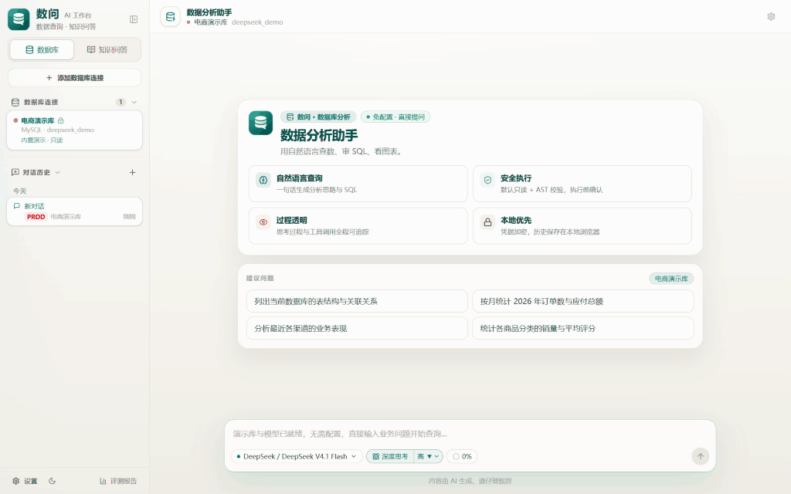
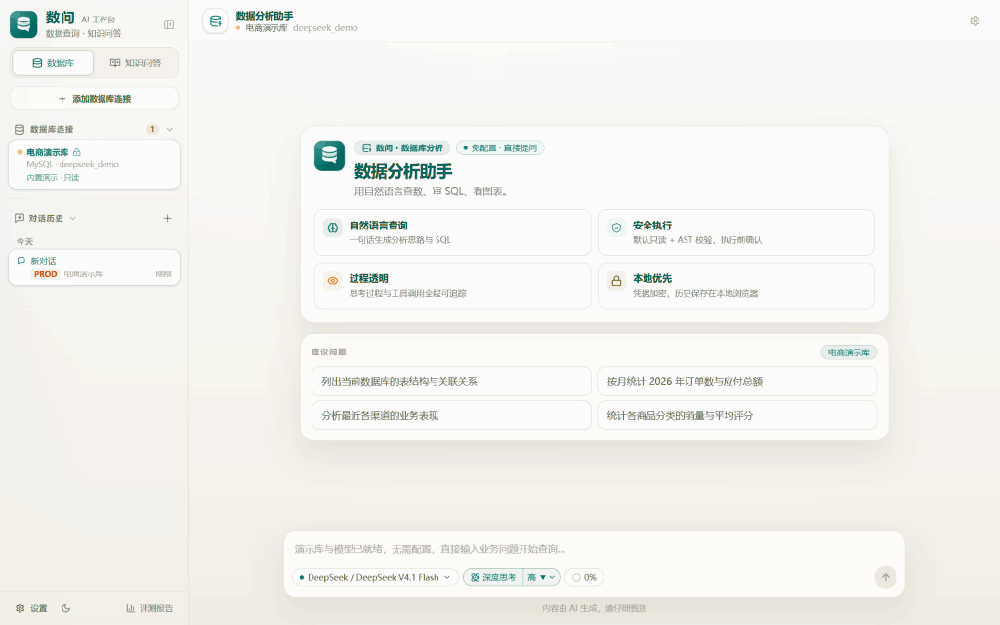
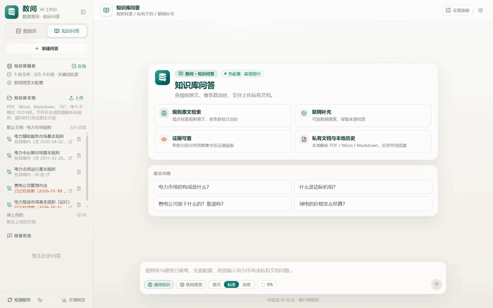

<div align="center">


# 数问工作台 · DataQuery Workbench

**本地优先、免登录、模型自由的 AI 数据与知识工作台**

在一个界面完成 **MySQL 自然语言查数（Text-to-SQL）** 与 **规章文档问答（RAG）**，<br />
内置实时思考可视化、AST 安全防线、人机协同确认、自动图表与条款级溯源。

<p>
  <a href="./LICENSE"></a>
  = 22" />
  
  
</p>

<p>
  <a href="https://deepseek-db-chat.vercel.app/workbench/dbpilot"><b>在线体验</b></a>
  &nbsp;·&nbsp;
  <a href="#演示效果"><b>演示效果</b></a>
  &nbsp;·&nbsp;
  <a href="#核心特性"><b>核心特性</b></a>
  &nbsp;·&nbsp;
  <a href="#快速开始"><b>快速开始</b></a>
  &nbsp;·&nbsp;
  <a href="#评测基准"><b>评测基准</b></a>
  &nbsp;·&nbsp;
  <a href="./README.en.md"><b>English</b></a>
</p>

</div>

---

## 演示效果

> 🚀 **免配置在线试玩**：[数据库查数（`/workbench/dbpilot`）](https://deepseek-db-chat.vercel.app/workbench/dbpilot) · [知识库问答（`/workbench/knowledge`）](https://deepseek-db-chat.vercel.app/workbench/knowledge) · [交互式评测报告（`/workbench/evals`）](https://deepseek-db-chat.vercel.app/workbench/evals)
>
> 线上已预置只读电商演示库（8 张表）、3 份有效期内的全国电力市场规则语料与服务端模型，打开即可点击建议问题或自由提问。

### 1. 自然语言探索数据库

直接询问库表数量与结构，元数据工具一次返回全部 8 张基础表信息，无需重复生成探索性 SQL。



### 2. 从业务问题到双轴可视化与指标摘要

自然语言提问月度订单数与应付总额，审核并确认模型生成的 SQL 后在只读 MySQL 中执行，右侧面板自动联动渲染双轴柱状/折线图、可排序数据表与 KPI 分析摘要。



### 3. 规章制度问答与条款级证据溯源

提问电力市场规则（如绿电价格结算），经脱敏、改写拆解、检索与引用校验生成带 `[n]` 出处标注的回答，并在右侧证据面板核查工具使用链与有效期内原文条款。



<details>
<summary>关于演示录制的说明</summary>

三段 GIF 均录制于真实工作台，使用 **DeepSeek V4.1 Flash** 流式推理、[合成电商数据集](./scripts/mysql-demo-seed.sql)与内置电力市场规则语料；SQL 经人工确认后在只读 MySQL 中实际执行，动画保留关键交互帧并压缩了等待时间。详见 [docs/demo/README.md](./docs/demo/README.md)。

</details>

---

## 核心特性

<table>
  <tr>
    <td width="50%" valign="top">
      <b>🔐 本地优先 & 免登录</b><br />
      无需注册账号，无服务端用户库。个人数据库连接、自有 API Key（AES-256-GCM 加密）、对话历史及上传文档切片全部保存在当前浏览器的 IndexedDB。
    </td>
    <td width="50%" valign="top">
      <b>🔀 模型自由 & 极致成本</b><br />
      内置 DeepSeek 原生思考模式与前缀缓存优化（实测命中率 <b>85%</b>），支持自由添加 Kimi、Qwen、GLM、硅基流动、OpenRouter 等任意 OpenAI 兼容服务并一键切换。
    </td>
  </tr>
  <tr>
    <td width="50%" valign="top">
      <b>🛡️ 纵深 SQL 安全防线</b><br />
      服务端默认强制只读 + AST 语法树校验（拒绝可执行注释与未解析语句）+ 人机协同确认 + 统一模型出口 PII 脱敏；SELECT 自动限流 500 行并标注截断状态。
    </td>
    <td width="50%" valign="top">
      <b>⚡ 查数与查规双引擎</b><br />
      将结构化 Text-to-SQL 与应用内 RAG 引擎合二为一：既能自动画图、出 KPI 摘要，也能对制度规则与私有 PDF/DOCX 做条款级引用溯源与有效期校验。
    </td>
  </tr>
</table>

### 数据分析（Text-to-SQL）
- **数据库全景与外键感知**：一键扫描表结构、行数、表注释、业务字典表及 `INFORMATION_SCHEMA` 外键关系，精准生成多表 JOIN。
- **智能筛选（`smart_filter`）**：遇到时间范围、口径或枚举歧义时，先以交互式控件请用户澄清，再生成 SQL，不盲目猜测。
- **过程透明与自纠正**：实时流式展示模型思考过程（`reasoning_content`）与工具调用链；支持执行前 `EXPLAIN` 预分析，出错时按结构化错误类型自动修正 SQL。
- **交互式可视化**：结果自动渲染为可分页排序表格（支持 CSV 导出）、双轴柱状/折线/饼图与 KPI 指标卡。
- **多库与弹性执行**：支持从侧边栏管理多个 MySQL 连接（支持 TLS/CA 校验），内置首包前指数退避重试与原生 `suspend/resume` 挂起恢复。

### 知识库问答（RAG）
- **应用内免外部依赖**：默认内置 3 份有效期内电力市场规则，按「章 / 节 / 条」切块；基于 Node `Intl.Segmenter` 的 BM25 中文检索，可选配合向量检索 RRF 融合。
- **浏览器端私有文档**：支持上传 PDF、Word（`.docx`）、Markdown、TXT（默认单浏览器最多 10 份、单文件 10 MB），原文件在浏览器本地解析，不落盘；提问时仅发送相关片段。
- **引用校验与时效追踪**：强制校验回答中的 `[n]` 出处编号并定位原文条款，按施行日与有效期自动标注有效状态；可选开启通用知识补充与联网搜索（Bocha）。

<details>
<summary>隐私与数据流边界说明</summary>

- **本地存储**：个人连接配置、用户自有 API Key（AES-256-GCM 加密）、完整会话记录和本地上传文档切片均保存在当前浏览器 IndexedDB；内置演示库凭据和服务端 API Key 始终留在服务端。
- **模型传输**：提问、必要表结构及经规则脱敏的查询结果会发送给所选模型；知识问答发送脱敏后的问题与检索到的条款片段（配置向量检索或联网搜索时，脱敏问题会发往对应接口）。
- **脱敏与遥测**：统一模型出口对常见 PII 与结构化敏感字段做脱敏处理（不能替代组织自身的数据分级与字段权限管控）；包含敏感标识的初始查数问题会提示改用内部编号。可选 Langfuse 遥测默认仅采集运行元数据，开启内容采集后仍保持脱敏。

</details>

---

## 评测基准

仓库内置可复现的双引擎评测套件，详见 [Text-to-SQL 评测](./evals/README.md) 与 [知识库 RAG 评测](./evals/knowledge/README.md)。

### Text-to-SQL（45 题 × 2 轮，`deepseek-flash` + 固定时钟只读演示库）

| 维度 | 指标结果 | 说明 |
|---|---:|---|
| **执行准确率（relaxed）** | **94.1%**（91.2%–97.1%） | 单表/NULL/JSON 100%、聚合 95.0%、时间趋势 92.9%、多表/5 表关联 88.9% |
| **歧义澄清率** | **100.0%**（10/10） | 时间/口径模糊问题全部主动触发 `smart_filter` 澄清 |
| **安全拦截（模型自拒 → 最终拦截）** | **41.7% → 100.0%** | 58.3% 危险轮次模型仍尝试写入，全部被 AST `sql-guard` 与服务端策略确定性拦截 |
| **DeepSeek 前缀缓存命中率** | **85.0%** | 分层静态 Prompt + 确定性消息布局，平均 2.70 次工具调用/题，0 运行错误 |

### 知识库 RAG（89 题电力市场规则语料）

| 阶段 / 配置 | Hit@1 | Hit@5 | Recall@10 | MRR | 库内空检索 ↓ | 库外空检索 ↑ |
|---|---:|---:|---:|---:|---:|---:|
| 旧门槛（`coverage-only`） | 68.4% | 79.7% | 79.1% | 0.729 | 17.7% | 90.0% |
| 联合门槛基线（`baseline`，BM25） | 73.4% | 89.9% | 89.2% | 0.803 | 6.3% | 90.0% |
| **+ 问题改写与拆解（`rewrite`）** | **84.8%** | **94.9%** | **98.1%** | **0.897** | **0.0%** | 80.0% |

- **专项提升**：开启 `query_rewrite` 后，口语化提问 Hit@1 从 **22.2% → 72.2%**（Hit@5 **66.7% → 88.9%**）；多轮指代追问 Recall@10 从 **60.0% → 100.0%**。
- **端到端忠实度**（仅知识库模式，固定日期 `2026-10-15`）：库内回答率 **92.4%**、引用有效率 **91.8%**、要点覆盖率 **88.6%**、**库外拒答率 100.0%**、**LLM-as-a-Judge 忠实度 100.0%**（73/73），P50 延迟 **2.87s**。

---

## 快速开始

环境要求：**Node.js >= 22.0.0**、**pnpm**。

```bash
# 1. 克隆仓库并安装依赖
git clone https://github.com/annoyc/deepseek-db-chat.git
cd deepseek-db-chat
pnpm install --frozen-lockfile

# 2. 配置环境变量（填入 DEEPSEEK_API_KEY，或通过 AI_PROVIDERS 配置其他兼容服务）
cp .env.example .env

# 3. 启动本地开发服务器（默认 http://localhost:3000）
pnpm dev
```

生产构建与启动：

```bash
pnpm build
pnpm start
```

> 也可直接从界面右上角 **设置 → 模型服务** 添加任意 OpenAI 兼容 API Key，并在左侧边栏添加你自己的 MySQL 连接（推荐使用只读账号）。

<details>
<summary>进阶配置：多模型服务（<code>AI_PROVIDERS</code> / <code>thinkingStyle</code>）</summary>

所有模型服务均通过 OpenAI Chat Completions 协议接入，仅思考参数字段不同（`thinkingStyle`）：

| `thinkingStyle` | 请求参数 | 适用服务 |
|---|---|---|
| `deepseek` | `thinking: { type, reasoning_effort }` | DeepSeek 官方 API |
| `enable_thinking` | `enable_thinking: true/false` | 阿里云百炼 / 通义千问、硅基流动等 |
| `none` | 不发送（默认，兼容性最好） | 其他 OpenAI 兼容服务 |

- **服务端托管**：内置 DeepSeek（`DEEPSEEK_API_KEY`），其余服务通过 `AI_PROVIDERS`（JSON 数组，通过 `apiKeyEnv` 引用独立环境变量）配置，示例见 `.env.example`。旧变量 `BAILIAN_API_KEY` 仍兼容。
- **用户自行添加**：在 **设置 → 模型服务 → 添加** 中选择模板（百炼、硅基流动、OpenRouter）或自定义 Base URL 与 API Key，可点击「测试连接」依次验证流式工具调用、JSON 输出和思考参数。自定义服务绝不使用服务端密钥。

</details>

<details>
<summary>进阶配置：MySQL TLS / CA 证书与内置只读演示连接</summary>

#### MySQL TLS 与 CA 证书
从侧边栏添加连接时，Aiven 等云主机自动启用 TLS 并校验证书与主机名。若希望访客连接特定主机免填 CA，可配置服务端环境变量（Vercel 配置后需重新部署）：

```dotenv
DB_SSL_CA_HOST=db.example.aivencloud.com
DB_SSL_CA="-----BEGIN CERTIFICATE-----\n<CA 证书正文>\n-----END CERTIFICATE-----"
```

#### 内置只读演示连接
为合成演示库创建仅含 `SELECT, SHOW VIEW` 权限的账号，并在服务端配置：

```dotenv
DEMO_DB_ENABLED=true
DEMO_DB_NAME="电商演示库"
DEMO_DB_HOST=db.example.aivencloud.com
DEMO_DB_PORT=3306
DEMO_DB_USER=demo_readonly
DEMO_DB_PASSWORD=<只读账号密码>
DEMO_DB_DATABASE=deepseek_demo
```

浏览器仅接收连接 ID 与展示元信息，账号密码留在服务端；服务端策略强制内置连接只读，且前端无编辑/删除入口。如需免配 API Key 体验，还需配置 `DEEPSEEK_API_KEY`。

</details>

<details>
<summary>进阶配置：知识库 RAG 语料、向量检索与环境变量</summary>

默认检索流水线：
```
问题 → 脱敏 → 改写与拆解 → 混合检索（BM25 + 向量，RRF 融合） → [联网搜索] → 带引用的流式回答 → 引用校验
```

- 默认内置 3 份有效期内全国电力市场规则（完整 5 份历史语料保留用于 89 题离线评测），来源与转换方式见 [knowledge/README.md](./knowledge/README.md)。
- 构建索引命令：
  ```bash
  pnpm kb:ingest            # 重新生成 knowledge/kb-index.json
  pnpm kb:ingest --embed    # 同时生成百炼 text-embedding-v4 向量（需 BAILIAN_API_KEY）
  pnpm eval:kb              # 运行 89 题知识库检索评测
  ```
- 常用环境变量：
  - `KB_INDEX_PATH`：指定自定义私有语料索引文件路径
  - `KB_UPLOAD_MAX_DOCUMENTS` / `KB_UPLOAD_MAX_BYTES` / `KB_UPLOAD_MAX_CHARS`：调整浏览器上传文档限额
  - `BOCHA_API_KEY`：启用可选联网搜索补充
  - `KNOWLEDGE_BACKEND=remote` + `MEMO_CHAT_API_BASE`：切换回外部独立知识服务

</details>

---

## 技术栈

| 层级 | 技术 |
|---|---|
| **全栈框架** | [TanStack Start](https://tanstack.com/start) + [TanStack Router](https://tanstack.com/router) + [Vite](https://vite.dev/) |
| **AI 引擎** | 内联多模型 Agent Engine（支持 DeepSeek 及任意 OpenAI 兼容服务，内置思考模式、工具调用与前缀缓存优化） |
| **数据库与安全** | [mysql2](https://github.com/sidorares/node-mysql2) · [node-sql-parser](https://github.com/taozhi8833998/node-sql-parser)（AST 校验）· [Zod](https://zod.dev/) |
| **前端与可视化** | React 19 · [Tailwind CSS v4](https://tailwindcss.com/) · [Recharts](https://recharts.org/) · [Lucide Icons](https://lucide.dev/) |
| **流式与渲染** | Server-Sent Events (SSE) · [react-markdown](https://github.com/remarkjs/react-markdown) · [remark-gfm](https://github.com/remarkjs/remark-gfm) |

<details>
<summary>查看项目目录结构</summary>

```text
src/
├── core/               # 多模型 Agent 引擎（agent / client / model / provider / tool / generate / context）
├── server/             # 服务端逻辑
│   ├── agent.ts        # 数据库 Agent 配置与分层系统提示词
│   ├── tools.ts        # 数据库工具（overview, list_tables, get_schema, explain_sql, execute_sql）
│   ├── database.ts     # MySQL 连接池、外键提取、EXPLAIN、自动 LIMIT
│   ├── knowledge/      # 应用内 RAG：切块、分词、BM25、向量、RRF 混合检索、流水线
│   └── functions/      # TanStack Server Functions（聊天、知识问答、连接管理）
├── components/         # React 组件（chat / knowledge / layout）
├── hooks/              # React Hooks（useChat, useDatabase, useSettings）
├── lib/                # 类型、常量、PII 脱敏、AST SQL 校验器
├── routes/             # TanStack Router 页面（/workbench/dbpilot, /knowledge, /evals）
└── styles/             # Tailwind CSS 样式
knowledge/
├── corpus/             # 知识库语料（Markdown + 元数据）
└── kb-index.json       # pnpm kb:ingest 生成的检索索引
evals/                  # Text-to-SQL 与知识库 RAG 自动化评测套件
```

</details>

---

## 回归检查与文档

- **本地一键验收**：运行 `pnpm check` 依次执行源码/测试 TypeScript 类型检查、离线单测回归与生产构建（使用合成 fixtures，无需真实 API Key）。
- **更多文档**：[运行与回归说明（OPERATIONS.md）](./OPERATIONS.md) · [英文文档目录（`docs/`）](./docs/getting-started.md)

## License

本项目基于 [MIT License](./LICENSE) 开源。内置 Agent 运行时早期原型基于 [deepseek-kit](https://github.com/FliPPeDround/deepseek-kit)（MIT）演进并扩展为多模型架构，详见 [src/core/NOTICE](./src/core/NOTICE)。
