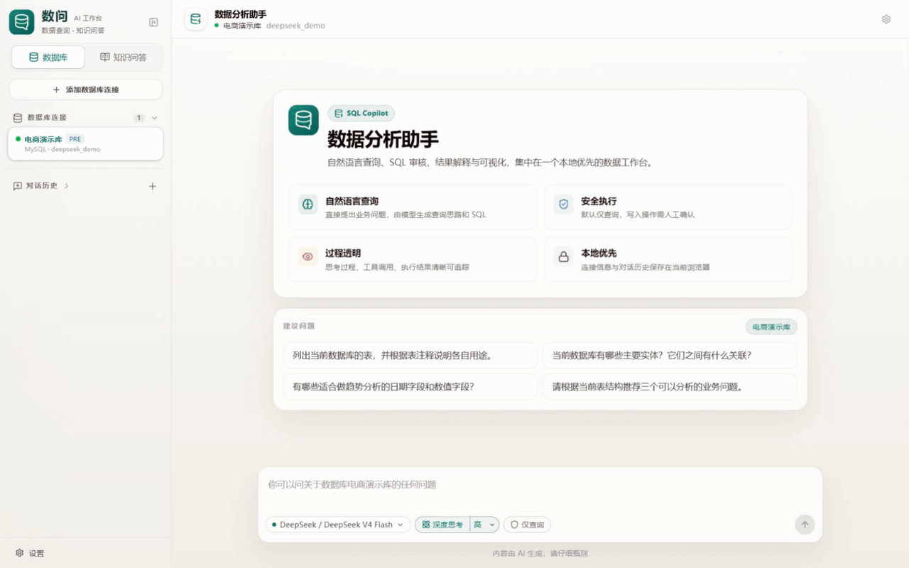
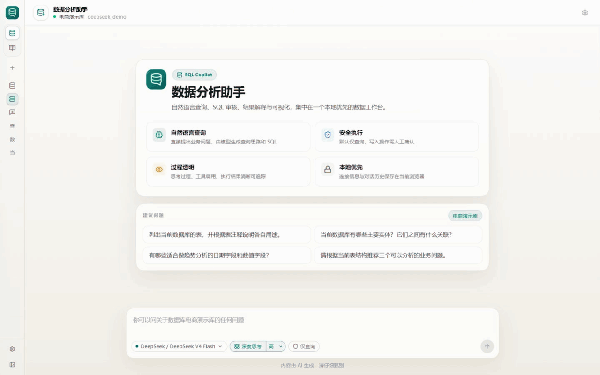

<p align="center">
  <h1 align="center">数问工作台 · DataQuery Workbench</h1>
</p>

<p align="center">
  多模型 AI 数据库领航助手 — 自然语言转 SQL，实时思考过程可视化，人工确认安全机制，以及自动数据可视化。
</p>

<p align="center">
  <a href="./LICENSE"></a>
  
  
  
</p>

<p align="center">
  <b><a href="./README.en.md">English</a></b> · <b><a href="./docs/getting-started.md">文档</a></b>
</p>

---

## 演示效果

[打开在线工作台](https://deepseek-db-chat.vercel.app/) · 无需配置数据库，即可先观看下方演示。

> 两段 GIF 录制于本地工作台，使用**真实 DeepSeek V4 Flash API**和[合成电商数据集](./scripts/mysql-demo-seed.sql)。SQL 经人工确认后在 MySQL 中实际执行；动画保留关键操作，压缩了等待时间。详见[录制说明](./docs/demo/README.md)。

部署方可以提供自动加载的内置只读演示连接。AI 查询还需要已配置的模型服务，也可以自行添加应用服务端可访问的 MySQL 连接。

### 1. 自然语言探索数据库

询问数据库有多少张表、查看表清单。元数据工具直接提供答案，避免重复生成 SQL。



### 2. 从业务问题到可视化结果

用自然语言提出业务问题，检查生成的 SQL，确认执行后查看查询结果和图表。



---

## 为什么选择数问工作台？

通用 AI 数据库工具依赖通用大模型 SDK，无法正确处理各厂商独有的思考模式和缓存机制。数问工作台支持多家大模型厂商（DeepSeek、阿里云百炼），深度集成各厂商特性，解决了其他工具无法解决的问题。

### 多模型 & 极致成本

支持 **DeepSeek**、**Kimi**、**Qwen**、**GLM** 等多款大模型，通过 DeepSeek 原生 API + 阿里云百炼（DashScope）双通道接入。内置 DeepSeek 前缀缓存优化与上下文复用，确定性消息构建确保缓存命中率最大化 — 自由切换模型的同时保持极致性价比。

### 安全可靠

数据库密码和用户自有 API Key 使用 AES-256-GCM 加密保存；服务器 API Key 始终留在服务器。SQL 在最终执行入口按服务器策略再次检查，默认只读；生产连接禁止写入，非生产写入必须由管理员显式启用并配置目标白名单。可执行注释及无法可靠解析的语句会被拒绝。SELECT 返回最多 500 行，并标明实际执行 SQL、限制与截断状态。生产数据库还应使用数据库自身的只读账号。详情见 [运行与回归说明](./OPERATIONS.md)。

### ️过程透明

AI 思考过程与工具调用完全可视化，每一步推理和 SQL 生成都有迹可循、可审计。**AI 想什么，你就看到什么** — 拒绝黑箱操作。

### 隐私无忧

个人连接和完整对话历史保存在当前浏览器的 IndexedDB，内置演示库的凭据始终留在服务器。提问、必要表结构和经规则脱敏的结果会发送给所选模型；知识问答会发送给配置的知识服务。统一模型出口对常见 PII 与结构化敏感字段脱敏，不能代替组织的数据分类与字段授权。Langfuse 为可选服务，默认仅采集运行元信息；内容采集需显式开启，开启后仍脱敏。包含敏感标识的初始数据库问题会提示改用非敏感内部编号，以免脱敏后生成错误筛选条件。

---

## 核心特性

- 🔀 **多模型支持** — DeepSeek / Kimi / Qwen / GLM 多款模型，通过 DeepSeek 原生 + 阿里云百炼双通道接入，界面内一键切换
-  **极致成本** — DeepSeek 前缀缓存优化，上下文复用，确定性消息构建，最大化缓存命中率
-  **安全可靠** — AES-256 密码加密、服务器默认只读、AST 校验、人工确认与统一模型出口脱敏
-  **智能筛选** — AI 驱动的交互式查询参数微调（时间范围、枚举筛选、聚合方式），SQL 生成前精准确认用户意图
-  **数据库全景** — 一键扫描全部表结构，含行数统计、表注释和外键关系映射，为 JOIN 查询提供精准依据
-  **外键感知** — Schema 检查自动提取 `INFORMATION_SCHEMA` 中的外键关系，AI 据此生成正确的多表 JOIN
-  **EXPLAIN 预分析** — 执行前可选的查询计划检查，自动预警全表扫描
-  **SQL 自纠正** — 失败时结构化错误分类（未知字段、表不存在、语法错误），引导 AI 智能修正而非盲目重试
- ️ **过程透明** — AI 思考过程与工具调用实时可视化，全程可审计
-  **隐私无忧** — 完整历史本地保存，模型与知识服务的数据传输范围明确，可选遥测默认不记录正文
-  **极致美观的数据可视化** — 查询结果自动渲染为交互式表格和图表（柱状图 / 折线图 / 饼图）
-  **弹性执行机制** — 自动重试 + 指数退避 + 可配置超时 + 智能错误恢复
- ️ **多数据库管理** — 从侧边栏添加、切换和管理多个 MySQL 连接
-  **智能 Agent 循环** — 内嵌 few-shot JOIN 示例的多步推理：全景扫描 → 检查表结构 → 生成 SQL → 确认 → 执行 → 出错自纠正
- ️ **默认思考模式** — `reasoning_content` 在多轮工具调用中正确管理，零配置
-  **SSE 流式传输** — 通过 Server-Sent Events 实时推送响应，即时反馈

---

## 快速开始

```bash
# 克隆仓库
git clone https://github.com/annoyc/deepseek-db-chat.git
cd deepseek-db-chat

# 安装依赖
pnpm install --frozen-lockfile

# 设置环境变量
cp .env.example .env
# 编辑 .env 并填入你的 API Key（DeepSeek 或百炼）

# 启动开发服务器
pnpm dev

# 构建生产版本
pnpm build
pnpm start
```

### MySQL 连接与 TLS

从侧边栏添加数据库连接，填写应用服务端可访问的主机、数据库名和只读账号。Aiven 主机会自动启用 TLS，TLS 连接会校验证书及主机名。CA 证书可从 Aiven 服务的 **Overview → CA certificate** 下载后导入，也可由部署方统一配置。

若希望访客连接指定主机时免填 CA，可设置以下服务端环境变量：

```dotenv
DB_SSL_CA_HOST=db.example.aivencloud.com
DB_SSL_CA="-----BEGIN CERTIFICATE-----\n<CA 证书正文>\n-----END CERTIFICATE-----"
```

将示例替换为完整、精确的数据库主机名及其公共 CA 证书。`DB_SSL_CA` 支持多行 PEM 或以 `\n` 表示换行。这些设置仅提供证书，个人连接仍通过界面添加。在 Vercel 项目环境变量中设置上述两项后，需要重新部署才能生效。

### 内置只读演示连接

使用独立的合成演示数据库，为演示账号仅授予该库的 `SELECT, SHOW VIEW` 权限，不授予 `DROP` 或全局权限。在服务端配置连接：

```dotenv
DEMO_DB_ENABLED=true
DEMO_DB_NAME="电商演示库"
DEMO_DB_HOST=db.example.aivencloud.com
# 使用数据库服务提供的实际端口。
DEMO_DB_PORT=3306
DEMO_DB_USER=demo_readonly
DEMO_DB_PASSWORD=<只读账号密码>
DEMO_DB_DATABASE=deepseek_demo
```

将 `DB_SSL_CA_HOST` 设置为相同主机名，并按上节配置 `DB_SSL_CA`。在 Vercel 的 Production 环境中添加这些变量，将 `DEMO_DB_PASSWORD` 保存为 Secret，再重新部署。新访客会自动加载并选中演示连接；浏览器仅接收连接标识和展示信息，账号、密码留在服务器。

内置连接没有编辑、删除入口。服务端按保留标识及数据库目标强制只读，即使其他连接允许写入也不会放开演示库。数据库只读账号同时阻止访客删表、删库；Aiven 所有者或数据库管理员仍可管理该库。个人连接仍可编辑、删除。

若希望访客无需自备模型密钥即可使用 AI 查询，还需在服务端配置 `DEEPSEEK_API_KEY`；数据库预设本身不会配置模型服务。

---

## 技术栈

| 层级 | 技术 |
|------|------|
| **框架** | [TanStack Start](https://tanstack.com/start) + [TanStack Router](https://tanstack.com/router) |
| **AI 核心** | 多模型 Agent Engine（DeepSeek + 百炼/DashScope，基于 [deepseek-kit](https://github.com/FliPPeDround/deepseek-kit)） |
| **数据库** | [mysql2](https://github.com/sidorares/node-mysql2) |
| **UI** | React 19 + [Tailwind CSS v4](https://tailwindcss.com/) + [Lucide Icons](https://lucide.dev/) |
| **图表** | [Recharts](https://recharts.org/) |
| **Markdown** | [react-markdown](https://github.com/remarkjs/react-markdown) + [remark-gfm](https://github.com/remarkjs/remark-gfm) |
| **校验** | [Zod](https://zod.dev/) + [node-sql-parser](https://github.com/taozhi8833998/node-sql-parser)（AST SQL 分析） |
| **流式传输** | Server-Sent Events (SSE) |
| **构建** | [Vite](https://vite.dev/) |

---

## 项目结构

```
src/
├── core/               # 多模型 Agent 引擎
│   ├── agent/          # Agent 创建与执行
│   ├── client/         # HTTP 客户端、SSE 流式请求、重试
│   ├── model/          # 模型封装（DeepSeek、百炼）
│   ├── provider.ts     # Provider 注册与端点解析
│   ├── tool/           # 工具定义与校验
│   ├── generate/       # Agent 循环、流式生成、结构化输出
│   ├── context/        # 上下文压缩
│   └── index.ts        # 公共 API 导出
├── server/             # 服务端逻辑
│   ├── agent.ts        # 数据库 Agent 配置 & 分层系统提示词（核心 + 工作流 + few-shot）
│   ├── tools.ts        # 数据库工具（overview, list_tables, get_schema, explain_sql, execute_sql）
│   ├── database.ts     # MySQL 连接池、外键提取、EXPLAIN、自动 LIMIT
│   └── functions/      # TanStack Server Functions（聊天、连接管理）
├── components/         # React 组件
│   ├── chat/           # 聊天 UI（消息、SQL 确认、图表、思考过程）
│   └── layout/         # 侧边栏、对话框、数据库列表
├── hooks/              # React Hooks（useChat, useDatabase, useSettings）
├── lib/                # 类型、常量、工具函数、PII 脱敏、AST SQL 校验器
├── routes/             # TanStack Router 页面
└── styles/             # 全局 CSS（Tailwind）
```

---


## 回归检查

执行 `pnpm check` 依次运行源代码与测试类型检查、离线回归及生产构建。测试使用合成数据和模拟模型/数据库，不需要真实 API Key。真实业务准确率与浏览器端到端验收应另行验证，详见 [OPERATIONS.md](./OPERATIONS.md)。
