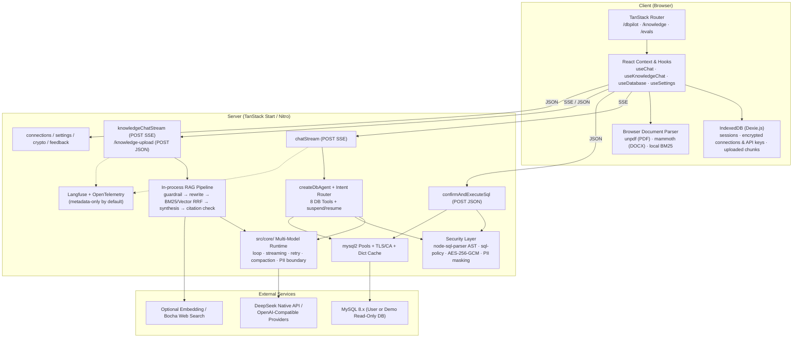
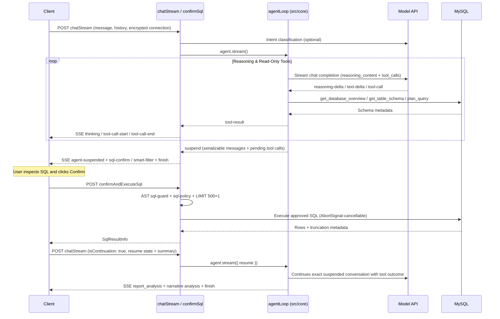
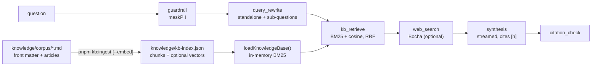

# DataQuery Workbench (数问工作台) — Architecture

DataQuery Workbench is a full-stack TypeScript AI workbench built on **TanStack Start**, **React 19**, and an inlined multi-model agent runtime (`src/core/`). It combines two complementary analytical engines in one workspace:

1. **DBPilot (`/dbpilot`)** — Natural-language Text-to-SQL assistant for MySQL with schema introspection, query planning, interactive parameter clarification (`smart_filter`), AST-enforced safety policies, human-in-the-loop SQL confirmation via `suspend/resume`, and automatic visualization.
2. **Knowledge Q&A (`/knowledge`)** — In-process Retrieval-Augmented Generation (RAG) engine over structured regulatory documents (with clause-level chunking, BM25 + optional vector RRF hybrid retrieval, query rewriting, client-side PDF/DOCX uploads, citation verification, and rule-validity tracking).
3. **Evaluation Dashboard (`/evals`)** — Self-contained HTML report generated from reproducible Text-to-SQL benchmarks (`evals/`).

---

## High-Level Architecture



| Layer | Responsibility |
|---|---|
| **Client (`src/routes/`, `src/components/`, `src/hooks/`)** | Multi-workbench UI, responsive chat + linked visualization side panel, SSE consumption, SQL confirmation & `smart_filter` dialogs, IndexedDB persistence, client-side PDF/DOCX extraction. |
| **Server Functions (`src/server/functions/`)** | SSE orchestration (`chat.ts`, `knowledge-chat.ts`), approved SQL execution (`confirm-sql.ts`), connection probing, AES-256-GCM encryption endpoints, chart classification, feedback. |
| **Agent Core (`src/core/`)** | Multi-provider OpenAI-compatible HTTP/SSE client, pre-first-event stream retry, unified PII egress masking, multi-step `agentLoop` with duplicate-call breaking, context compaction, and `suspend/resume`. |
| **Database & Safety (`src/server/database*.ts`, `src/lib/sql-guard.ts`, `src/server/sql-policy.ts`)** | `mysql2` connection pooling, TLS/CA verification, foreign-key & dictionary-table introspection, schema subsetting, fail-closed AST SQL validation, sentinel `LIMIT 500+1` truncation detection. |
| **Knowledge RAG (`src/server/knowledge/`, `src/lib/retrieval/`)** | Clause-level Markdown chunker, `Intl.Segmenter` + CJK bigram tokenizer, Okapi BM25, optional dense vector cosine + RRF fusion, query rewriting/decomposition, citation verification, and validity-date checks. |

---

## Technology Stack

| Category | Technology |
|---|---|
| Framework | TanStack Start + TanStack Router + Nitro |
| UI & Visualization | React 19, Tailwind CSS v4, Radix UI, Lucide Icons, Recharts, react-markdown |
| AI Runtime | Inlined multi-model engine (`src/core/`, evolved from `deepseek-kit`) |
| LLM Providers | Built-in DeepSeek native thinking API + server-managed or user-configured OpenAI-compatible providers |
| Database Driver | `mysql2` (promise API, TLSv1.2+, `bigNumberStrings`) |
| Validation & Safety | Zod v4, `node-sql-parser` (MySQL AST), Node `crypto` (AES-256-GCM) |
| Client Storage & Parsing | Dexie.js (IndexedDB), `unpdf`, `mammoth` |
| Observability | `@langfuse/otel` + `@langfuse/tracing` + OpenTelemetry |
| Build & Testing | Vite 7, TypeScript 5.8, Node `node:test` runner |

---

## DBPilot Agent & Human-in-the-Loop Flow

### Registered Tools (`src/server/tools.ts`)

| Tool | Touches DB? | Behavior |
|---|---|---|
| `get_database_overview` | Read-only | Returns table list, comments, approximate row counts, foreign-key relationships, and query-relevant schema subsets. |
| `list_tables` | Read-only | Exact count and listing of `BASE TABLE` or `VIEW` objects for metadata questions without generating SQL. |
| `get_table_schema` | Read-only | Returns columns, types, indexes, foreign keys, `ENUM` values, and auto-detected dictionary table labels (`sys_dict_data`, etc.). |
| `plan_query` | Read-only | Plans multi-table/complex queries and automatically prefetches schemas for all involved tables. |
| `explain_sql` | Read-only | Runs `EXPLAIN` to inspect execution plans and warn about full-table scans before execution. |
| `smart_filter` | No (`suspend`) | Suspends the agent loop and renders interactive filter controls (date range, options, aggregation granularity) for ambiguous queries. |
| `execute_sql` | No (`suspend`) | Validates SQL via AST + server policy, then suspends the agent loop so the user can review, edit, approve, or cancel before execution. |
| `report_analysis` | No | Emits structured key metrics, chart recommendations, and follow-up suggestions alongside narrative analysis. |

### Native `suspend / resume` Execution Cycle

Instead of breaking the SSE stream imperatively and reconstructing synthetic prompts from scratch, `execute_sql` and `smart_filter` return `suspend(payload)` inside `src/core/generate/generate-loop.ts`:



If a resumed state is missing, stale, or fails validation (`parseSuspendedState`), the server gracefully falls back to a fresh turn constructed from the visible conversation history.

---

## Security & Privacy Boundaries

- **Credentials & Storage**: All chat sessions, user connections, and user-supplied API keys live in browser **IndexedDB**. Passwords and API keys are encrypted server-side with **AES-256-GCM** (`ENCRYPTION_KEY`) before being persisted in the browser; built-in demo DB credentials (`DEMO_DB_*`) and server AI keys never leave the server.
- **Credential Containment**: `src/server/ai-credentials.ts` confines server-managed API keys strictly to administrator-configured endpoints and rejects HTTP redirects (`redirect: 'error'`) so credentials cannot be exfiltrated.
- **Fail-Closed SQL Enforcement**: `src/lib/sql-guard.ts` parses SQL into an AST (`node-sql-parser`), rejecting unparseable syntax, multiple statements, executable comments, `SELECT INTO`, locking reads, session variables, and dangerous functions. `src/server/sql-policy.ts` enforces read-only mode by default, blocks writes on production/demo targets, and requires both `SQL_WRITE_ENABLED=true` and an exact `SQL_WRITE_ALLOWLIST` match for non-production writes.
- **Unified Egress Masking**: `src/lib/masking.ts` scrubs common PII patterns (phone numbers, national IDs, bank cards, emails, and sensitive structured fields) at the HTTP boundary before requests leave for model, embedding, or search APIs.
- **Privacy-Safe Telemetry**: Langfuse tracing (`src/server/langfuse.ts`) defaults to metadata-only spans (no prompts, answers, SQL, database names, or IPs). Content capture requires `LANGFUSE_CAPTURE_CONTENT=true` and remains PII-masked.

---

## Knowledge Q&A (RAG)

The knowledge workbench (`/knowledge`) runs in-process by default (`KNOWLEDGE_BACKEND=remote` restores proxying to `MEMO_CHAT_API_BASE`), emitting a unified `KnowledgeStreamChunk` SSE protocol:



| Module (`src/server/knowledge/`) | Responsibility |
|---|---|
| `corpus.ts`, `chunker.ts` | Parse front matter; clause-level chunking (`第X条` & glossary entries), splitting overly long articles and merging short neighbors. |
| `src/lib/retrieval/tokenizer.ts`, `bm25.ts` | `Intl.Segmenter` words + CJK bigrams; Okapi BM25 with coverage + matched-IDF relevance gate. |
| `embedding.ts`, `index-builder.ts` | Optional server-key embeddings via OpenAI-compatible `/embeddings`; vectors cached by content hash. |
| `retriever.ts` | Per-query keyword and dense rankings fused with Reciprocal Rank Fusion (`k = 60`). |
| `validity.ts` | Computes document validity status (in force / expired / not yet effective) in Beijing time at question time. |
| `pipeline.ts`, `prompt.ts`, `citations.ts` | Stage orchestration, cache-friendly citation prompts, strict no-evidence refusal, and citation index validation. |

Users can upload PDF, DOCX, Markdown, and TXT files parsed entirely in the browser (`src/lib/document-text.ts`, lazy-loaded `unpdf` and `mammoth`). Extracted text is chunked (and optionally embedded) via `/knowledge-upload` without server persistence and stored in IndexedDB. At query time, the browser pre-ranks local chunks with the same BM25 implementation and sends up to 30 candidates to fuse with built-in provisions.

---

## Project Structure

```text
deepseek-db-chat/
├── src/
│   ├── core/                  # Multi-model Agent runtime (loop, suspend, stream, retry, compact)
│   ├── server/
│   │   ├── agent.ts           # DBPilot agent configuration & layered system prompt
│   │   ├── tools.ts           # 8 DB tools (overview, list_tables, schema, plan, explain, filter, sql, report)
│   │   ├── database*.ts       # mysql2 pooling, TLS/CA, FK & dictionary introspection, query execution
│   │   ├── sql-policy.ts      # Server-side read-only / write allowlist policy
│   │   ├── ai-credentials.ts  # Provider target resolution & server-key containment
│   │   ├── knowledge/         # In-process RAG pipeline (chunking, BM25/vector RRF, citations, validity)
│   │   └── functions/         # TanStack Server Functions (chat, confirm-sql, knowledge-chat, settings)
│   ├── components/            # React UI (chat/, knowledge/, layout/, ui/)
│   ├── hooks/                 # Client state & IndexedDB hooks
│   ├── lib/                   # Shared types, AST sql-guard, PII masking, retrieval, result formatting
│   └── routes/                # TanStack Router (/dbpilot, /knowledge, /evals, /knowledge-upload)
├── knowledge/                 # Regulatory Markdown corpus & prebuilt kb-index.json
├── evals/                     # Text-to-SQL & RAG evaluation suites, baselines, and HTML report generator
├── tests/                     # 200+ offline regression tests (security, agent, RAG, UX, evals)
└── docs/                      # Architecture, setup, configuration, and evolution docs
```
